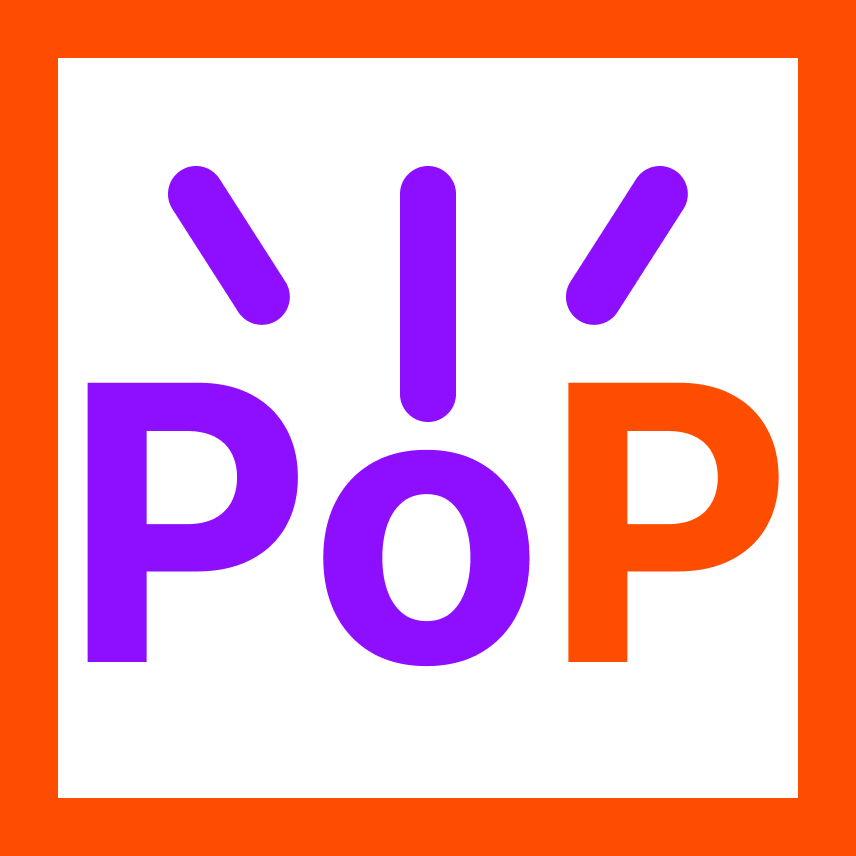

<p align="center">
  
</p>

# ⚡ PowerPopup

A browser extension that gives you a quick-launch "pocket" for Power Apps. Instead of
bouncing between bookmarks and the maker portal, open the launcher and drill:
**Environments (Dev/Prod) → Apps & Solutions → Solution components**, with one click
landing you directly in the right editor.

- **Toolbar popup** — `Alt+Shift+P` (or click the icon): miller-column UI with a filter box.
- **Edge pocket** — a slim handle pinned to the right edge of every page by default (drag it
  vertically to reposition, click or `Alt+Shift+O` to fly out your pinned items). Turn it off
  globally in Options if you don't want it.
- **Same-origin data access** — apps, solutions, and solution components come live from
  each environment's Dataverse Web API (the same `msdyn_solutioncomponentsummaries` view
  the maker portal uses), read **through an open, signed-in org tab** — no tokens.
- **Direct deep links** — canvas apps open in Studio, model-driven apps in the app
  designer (with a ▶ Play / ✏ Edit split), flows in Power Automate, tables in the table
  designer; anything else falls back to the solution page.
- **Pins** — star anything (environment, app, solution, component) to keep it at the top.
  The ✎ on the Pinned header turns the list into an editor: rename entries to whatever you
  actually call them, and drag them into the order you want (the edge pocket follows suit).
- **Dev/Prod tagging** — tag environments in Options; the popup groups and color-codes
  them (green DEV / red PROD).

Results are cached locally for 15 minutes; the ⟳ button force-refreshes the current column.

## How auth works (the Level Up model)

PowerPopup never registers an Entra app, never harvests tokens, and never stores
secrets. Like the *Level Up for Dynamics 365* extension, it relies on the Dataverse org
page you're already signed in to:

- `content/org.js` runs on `https://*.crm*.dynamics.com` pages and performs **read-only,
  same-origin** Web API GETs (`fetch('/api/data/v9.2/…', { credentials: 'include' })`).
  The org's own session cookie authorizes the request — no bearer token, no OAuth.
- The background worker relays queries to that tab over extension messaging and caches
  results for 15 minutes.
- When an org tab loads, the content script verifies the session with `WhoAmI`, fetches
  the org's friendly name + Environment ID (`RetrieveCurrentOrganization`), and auto-adds
  the environment to your list.

**Consequence:** loading data for an environment requires an open, signed-in tab of that
org. If none is open, the popup tells you and offers to open `https://yourorg.crm.dynamics.com`
for you. The 15-minute cache means you don't need the tab for every click.

### Environment discovery

Global Discovery needs a bearer token, so it isn't used by default. Instead the
environment list in Options is:

- **auto-populated** whenever a `*.crm*.dynamics.com` tab is detected, and
- **user-editable** — add org URLs + friendly names by hand, tag Dev/Prod, remove.

## Setup

1. **Load the extension**
   - **Edge:** `edge://extensions` → enable Developer mode → **Load unpacked** → this folder.
   - **Chrome / Vivaldi:** `chrome://extensions` (`vivaldi://extensions`) → same steps.
   - **Firefox:** replace `manifest.json` with `manifest.firefox.json` (rename it), then
     `about:debugging` → This Firefox → **Load Temporary Add-on**.
2. **Open your org** — visit `https://yourorg.crm.dynamics.com` signed in. The environment
   appears in the popup automatically.
3. Optionally tag environments **DEV** / **PROD** in Options and enable the edge pocket.

### Optional fallback: your own Entra app registration

Only needed if you want to query environments *without* keeping an org tab open, or to
list environments via Global Discovery. The extension then authenticates as *you* using
OAuth + PKCE (no secrets stored); after a one-time consent, sign-in is silent.

1. [Azure portal](https://portal.azure.com) → **Entra ID → App registrations → New registration**.
2. **Authentication → Add a platform → Mobile and desktop applications** → add the redirect
   URI shown on the extension's Options page.
3. **API permissions → Dynamics CRM → Delegated → `user_impersonation`**, grant consent.
4. Paste the client ID + tenant ID into Options.

## Building a package

Only needed to submit to a store or hand someone a build — loading unpacked (see
[Setup](#setup)) needs no build step. `build.sh` stages each target with its own
manifest and writes to `dist/`:

```bash
./build.sh            # both
./build.sh chrome     # dist/PowerPopup-chrome.zip  (Chrome, Edge, Vivaldi)
./build.sh firefox    # dist/PowerPopup-firefox.xpi (AMO)
```

It archives with `zip` when that's on `PATH` and otherwise falls back to Python's
`zipfile`, so each OS needs **one** of the two:

| OS | Run it from | Archiver |
|---|---|---|
| **Windows** | Git Bash, bundled with [Git for Windows](https://git-scm.com/download/win) — not cmd or PowerShell | Neither `zip` nor 7-Zip ships with Windows, so this uses the Python fallback: `winget install Python.Python.3.13` |
| **macOS** | Terminal | `zip` is preinstalled |
| **Linux** | any shell | `zip` (`sudo apt install zip`, `sudo dnf install zip`), or Python 3 |

On macOS and Linux, mark it executable once with `chmod +x build.sh`.

## How it's put together

| File | Role |
|---|---|
| [background.js](background.js) | Message hub: org-tab relay, environment list, 15-min cache, pin storage |
| [content/org.js](content/org.js) | Org-tab agent: same-origin, cookie-authorized, read-only Web API GETs + org auto-detection |
| [lib/dataverse.js](lib/dataverse.js) | Dataverse query paths + row mappers (executor injected: org-tab relay or fallback token fetch) |
| [lib/auth.js](lib/auth.js) | Optional own-app fallback: PKCE via `launchWebAuthFlow`, silent SSO first |
| [lib/jwt.js](lib/jwt.js) | Tiny JWT claim decoder + resource-origin normalizer (fallback path only) |
| [lib/urls.js](lib/urls.js) | **All deep-link URL patterns.** If Microsoft changes a maker-portal URL, fix it here only. |
| [popup/](popup/popup.js) | Miller-column launcher UI; also rendered inside the pocket iframe (`?pocket=1`) |
| [content/pocket.js](content/pocket.js) | Edge handle + fly-out panel in a closed shadow root on every page |
| [options/](options/options.js) | Environment list (auto + manual), Dev/Prod tagging, pocket toggle, optional Entra config |

No build step, no dependencies — plain ES modules loadable as an unpacked extension.
[`build.sh`](build.sh) only zips those same files up for store submission.

## Notes & known edges

- **Read-only by design**: the org-tab agent only performs GETs; there is no write path.
- **Deep-link drift**: Microsoft occasionally reshuffles maker-portal URLs. Everything is
  centralized in `lib/urls.js`; the model-driven app-designer pattern in particular may
  need a tweak for your region/ring.
- **Environment ID for deep links**: maker-portal links need the environment GUID, which
  is read from `RetrieveCurrentOrganization` when an org tab is first seen. Manually added
  environments get it filled in the first time you load their data with a tab open.
- **Canvas apps list**: read from the Dataverse `canvasapps` table; environments without
  Dataverse (or where the table is restricted) just show model-driven apps.
- **Forms/views deep links**: component types without a reliable direct-editor URL fall
  back to opening the solution page — extend `componentUrl()` in `lib/urls.js` if you want
  form-editor links.
- **Quick sanity check**: on a signed-in org tab, paste this in DevTools —
  `fetch('/api/data/v9.2/WhoAmI',{credentials:'include',headers:{Accept:'application/json'}}).then(r=>r.json()).then(console.log)`
  — a `UserId` response confirms the same-origin model works in your org.
